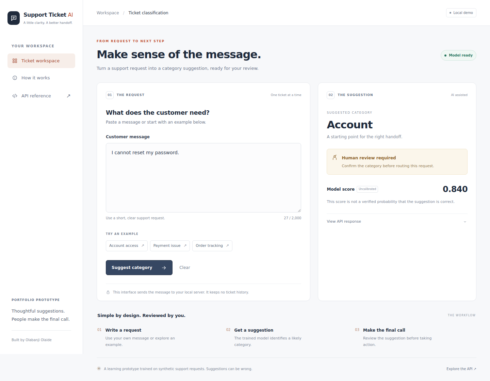

# Support Ticket AI

A Python portfolio project for classifying support requests and routing uncertain predictions to human review.

The [responsive workspace refresh](docs/36-responsive-workspace.md) adds light/dark themes, phone-to-desktop layouts, keyboard submission, cancellable requests, and copyable review summaries. See the guide for screenshots and the update commands.

The [public repository review and research roadmap](docs/25-public-repository-review.md) compares related projects and proposes a path toward structured support actions with inspectable text evidence. It distinguishes established methods from unvalidated research hypotheses; no novelty or external-benchmark performance is claimed.

The first implementation step adds a validated [action-plan format and public benchmark importer](docs/26-action-plan-and-public-benchmark.md). BlendBanking77 is prepared with its native 77 labels, disjoint development partitions, pinned provenance, and opaque test payloads. This is offline preparation; the browser still uses the existing reviewed category predictions.

Offline multi-intent studies use 2,008 reused development requests with 77 native banking labels, separate from the browser's 11 support categories:

| Recorded recipe | Complete label-set accuracy | Guide |
|---|---:|---|
| Word TF-IDF, C=1 | 28.49% | [First multilabel baseline](docs/27-first-multilabel-baseline.md) |
| Frozen sentence embeddings, C=1 | 35.81% | [Semantic comparison](docs/28-semantic-multilabel-comparison.md) |
| Frozen sentence embeddings, C=10 | 42.23% | [Class weights and regularization](docs/29-semantic-head-study.md) |
| Frozen sentence embeddings, C=10, tighter solver tolerance | 45.32% | [Numerical control audit](docs/30-segment-pooling.md#numerical-follow-up) |

The [segment-pooling study and numerical audit](docs/30-segment-pooling.md) expose a failed duplicate-vector control at the default optimizer tolerance. Tighter stopping reduces disagreements from 85 to zero predicted label sets on this partition and supplies the 45.32% whole-message reference. The nominal pooling gain is not promoted as a verified representation improvement. The guides retain the recorded recipes and qualify their numerical interpretation. Calibration/final-test data remain unused by these experiments; the live app is unchanged.

The [matched strict-solver comparison](docs/31-matched-segment-comparison.md) passes the numerical control but rejects both pooling candidates under its predeclared rule. Mean pooling reaches 46.07% overall while three-intent correct sets fall from 41 to 38; whole-message features remain the 45.32% development reference. Package 0.10.0 adds `--stable` and a reproducible manual workflow for this comparison.

The [native app solver comparison](docs/32-native-solver-comparison.md) tests tighter fitting on the actual 11-category semantic model. All 98 known development cases retain the same suggestions and review decisions, so the existing browser model is retained. Package 0.10.1 adds the reproducible offline comparison; no new labeling is required.

The [error analysis](docs/33-error-analysis.md) traces the remaining wrong suggestions and missed REVIEW cases to spelling, indirect wording, insufficient context and declarative multiple-problem descriptions. It identifies a separate clarification decision as the next experiment to design; this analysis adds no model or browser change.

The [offline clarification prototype](docs/34-clarification-prototype.md) proposes a follow-up question for narrowly recognized generic failure statements. Replaying the known development results with the existing optional guard increases REVIEW withholding from 5/8 to 7/8 while preserving 52/66 supported suggestions. The rules were designed after inspecting these failures; this is a development regression result, not an independent accuracy estimate or browser update. Package 0.11.0 includes the replay command and 24 provisional contrast checks.

The [offline problem-statement check](docs/35-problem-statements.md) catches the known login-plus-payment miss and proposes which issue to address first. Its fixed English rules preserve supported suggestion counts in the replay and pass 30 authored contrast checks. These are targeted development regressions, not independent performance evidence; the browser stays unchanged. Package 0.12.0 adds the replay command and exact source-text evidence spans.

**Optional semantic browser mode is now available:** [setup and launch guide](docs/21-semantic-browser-mode.md). The word model remains the default; semantic mode requires a separately built bundle and optional CPU dependencies. Every prediction requires human review.

Semantic mode also offers an unchecked [experimental separate-request check](docs/24-separate-request-check.md). On known development probes it withholds two additional multi-intent requests without changing supported-request coverage. It is a bounded rule-based option, not a trained general ambiguity detector; the guide documents remaining misses. Existing semantic bundles need no rebuild.

The [encoder fine-tuning pilot](docs/22-encoder-fine-tuning-pilot.md) compares one fixed train-only adaptation run with frozen sentence embeddings offline. Correct top categories on 66 supported development probes fall from 56 to 54 despite a small synthetic-validation gain, so the frozen encoder stays in the browser. The report documents the regressions; no additional manual labeling is required.

The [spelling-robustness pilot](docs/23-spelling-robustness-pilot.md) combines frozen embeddings with character fragments. Correct typo categories rise from 16/22 to 17/22, but indirect wording regresses and overall correct categories remain 56/66. The candidate stays offline; the browser model is unchanged.

**Manual labeling is paused.** The application has an [installable package and browser verification](docs/19-installable-package.md), with a [short recruiter walkthrough](docs/20-recruiter-walkthrough.md). The pending review collection requires no action to run or present the application.

**Status: baseline, prediction CLI, local FastAPI service, similarity audit, and offline calibration experiment implemented.** Calibration is not activated in the live prediction interfaces. The test set has not been evaluated. All predictions require human review. Optional experimental abstention can withhold low-scoring category suggestions.

See [the baseline audit and results](docs/04-baseline-results.md). Validation macro-F1 is 0.9984 on a synthetic source; template overlap may inflate this result. It is not a production accuracy claim.

The [prediction and overlap guide](docs/05-prediction-and-overlap.md) documents the command-line interface, similarity measurements, and an observed error on a manually written payment request.

The [API guide](docs/06-prediction-api.md) explains local startup, request validation, and liveness/readiness checks. No hosted service has been deployed.

The [calibration experiment](docs/08-calibration-experiment.md) improved development probability metrics but increased confidence in a known wrong suggestion. Its threshold policy remains an offline simulation.



The [abstention experiment](docs/11-experimental-abstention.md) adds an opt-in “No reliable suggestion” outcome. On its small authored audit set it withheld all 12 unrelated requests, but also withheld 8 of 11 valid support requests. It is a score-based baseline, not a general unsupported-request detector.

The [broader robustness diagnostics](docs/12-robustness-diagnostics.md) add 98 provisional stress probes, per-category and writing-style reports, and a label-review protocol. At the frozen 0.70 cutoff, only 14/66 valid probes receive a suggestion and 4/24 unrelated tasks still pass. These diagnostic findings motivate further model work; they are not independent accuracy estimates.

The [character-feature experiment](docs/13-character-feature-experiment.md) compares a fixed spelling-tolerant candidate with the word baseline. Correct categories on provisional supported probes rose from 34/66 to 45/66 before abstention, but coverage and unrelated-task failures remain unresolved. The character-feature candidate remains offline. The optional browser mode uses frozen sentence embeddings; the default word model is unchanged.

The [scope-detector experiment](docs/14-scope-detector-experiment.md) adds a separate binary support-scope gate offline. Combined with the word-category cutoff, unrelated false suggestions fall from 4/24 to 1/24 while supported coverage remains 14/66 on existing provisional probes. Negative training examples reflect known failure families, so these are development findings, not independent audit results.

The [frozen semantic-embedding experiment](docs/15-semantic-embedding-experiment.md) improves indirect wording on provisional probes: 18/22 correct versus 10/22 for word features. With a separately selected cutoff and semantic scope gate, it accepts 52/66 valid probes (49 correct) and rejects 24/24 unrelated probes, but accepts 5/8 ambiguous requests. It is available through the explicit experimental browser mode, and the guide discloses a training duplicate discovered in the older cutoff-selection collection.

The [human label-review pilot](docs/16-human-label-review.md) provides a workflow for interpreting 40 unscored requests, five at a time, without model suggestions. It supports one routing intent, multiple routing intents, insufficient context, and unsupported tasks. The completed assisted review and its limitations are documented in the reconciled evaluation below; these are not independently adjudicated labels.

The [reconciled pilot evaluation](docs/17-reviewed-pilot-evaluation.md) checks 40 assisted human-reviewed development labels using frozen cutoffs. The semantic-plus-scope policy routes 20/24 clear requests correctly and rejects 8/8 unrelated tasks, but still passes 3/4 multiple-intent and 2/4 unclear requests. Individual review records remain private; aggregate results show why ambiguity handling is still needed.

The [broader ambiguity review collection](docs/18-ambiguity-review-collection.md) adds 72 unlabeled requests with scenario-family reservations made before training: 48 train, 12 selection, and 12 audit. Human review is pending; no model has scored this collection and no ambiguity capability is claimed yet.

## Run the complete demo

From the repository root, with Python 3.11–3.13 in a virtual environment:

```bash
python -m pip install .
support-ticket-demo artifacts/demo-v1
support-ticket-serve --model-dir artifacts/demo-v1/model
```

The demo downloads approximately 19 MB of pinned source data, verifies checksums, prepares splits, trains the baseline, and creates a trusted local model bundle. Use a fresh output path on each run. Open http://127.0.0.1:8000/ for the ticket workspace. The developer API reference remains at http://127.0.0.1:8000/docs.

See [complete setup and phone instructions](docs/07-running-the-demo.md). From your phone, the **Build local demo bundle** GitHub Actions workflow can build a downloadable model and reports. This workflow does not host the API.

See [the workspace guide](docs/09-ticket-workspace.md) for examples, result explanations, and updating an existing local checkout without retraining.

## Run the first milestone

Python 3.11–3.13 is supported. The demo loader uses the standard library. Install the pinned dependencies for model training and the full test suite.

```bash
python -m pip install -r requirements.txt
python -m support_ticket_ai data/sample_tickets.csv
python -m unittest discover -s tests -v
```

Run commands from the repository root. The sample-data command prints the number of tickets per category. Invalid data produces an error and a nonzero exit code.

## Data contract

The original demo CSV must contain `ticket_id`, `text`, and `category`. IDs must be unique; every field must be nonempty. Its default categories are `billing`, `account`, and `technical`. Extra columns are permitted and ignored. Files use UTF-8, with an optional byte-order mark.

The trained Bitext model uses the source dataset's 11 categories instead, including ACCOUNT, PAYMENT, and ORDER. The importer preserves those labels and records their vocabulary in the preparation manifest. See [the baseline audit](docs/04-baseline-results.md) for the complete list.

`data/sample_tickets.csv` contains 12 hand-written synthetic examples for demonstrating the loader. It is not a benchmark, training corpus, or evidence of model quality. Do not upload real customer tickets or personal information.

## Planned milestones

1. **Complete:** CSV validation, command-line summary, tests, and an automated test workflow.
2. **Complete:** pinned source import, data audit, provenance manifest, and duplicate-aware splits. See [preparation instructions](docs/03-importing-and-splitting.md).
3. **Complete:** majority-class and TF-IDF/logistic-regression baselines; validation macro-F1, class metrics, and confusion matrix.
4. **Complete locally:** CLI and prediction API, input validation, checked model bundles, versioned output, and health/readiness checks.
5. **Offline experiment complete:** temperature scaling and threshold simulation on disjoint validation subsets; live automatic routing remains disabled.
6. **Complete locally:** pinned-download demo builder, portable server command, limitations guide, and GitHub Actions bundle workflow.

Validation and exploratory calibration metrics are available; held-out test performance and calibration under distribution shift remain unestablished. Workflow status should be checked in the Actions tab.

## Learn from your phone

Read [the first learning guide](docs/01-data-contract.md), inspect `support_ticket_ai/data.py`, and open the repository's Actions tab to see automated checks. A local terminal is optional for reviewing this milestone.

## Layout

- `support_ticket_ai/`: loader and command-line entry point
- `data/`: synthetic demonstration CSV
- `tests/`: validation and command-line behavior checks
- `docs/`: practical learning notes
- `.github/workflows/`: automated checks
