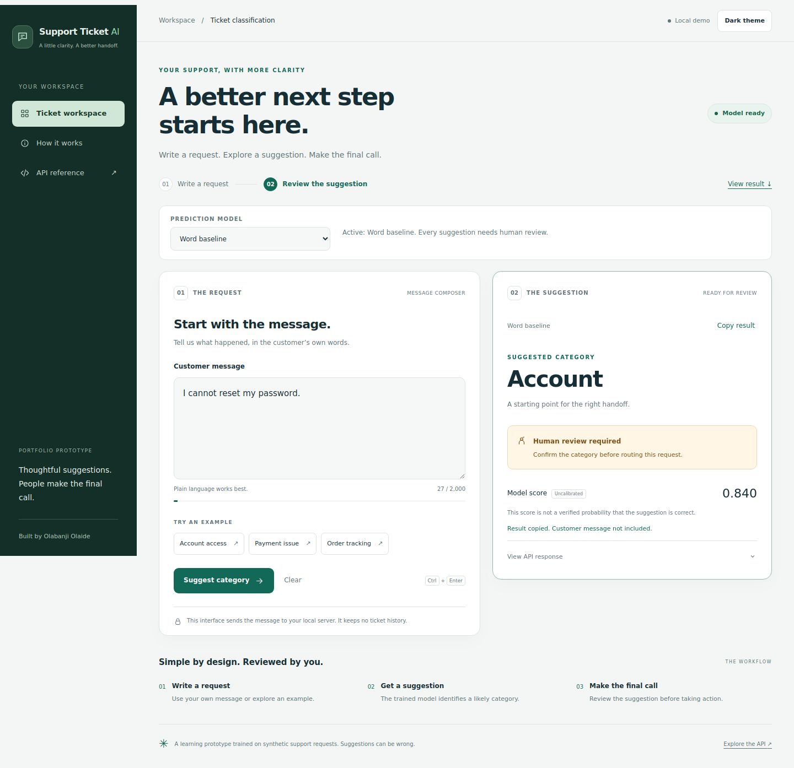
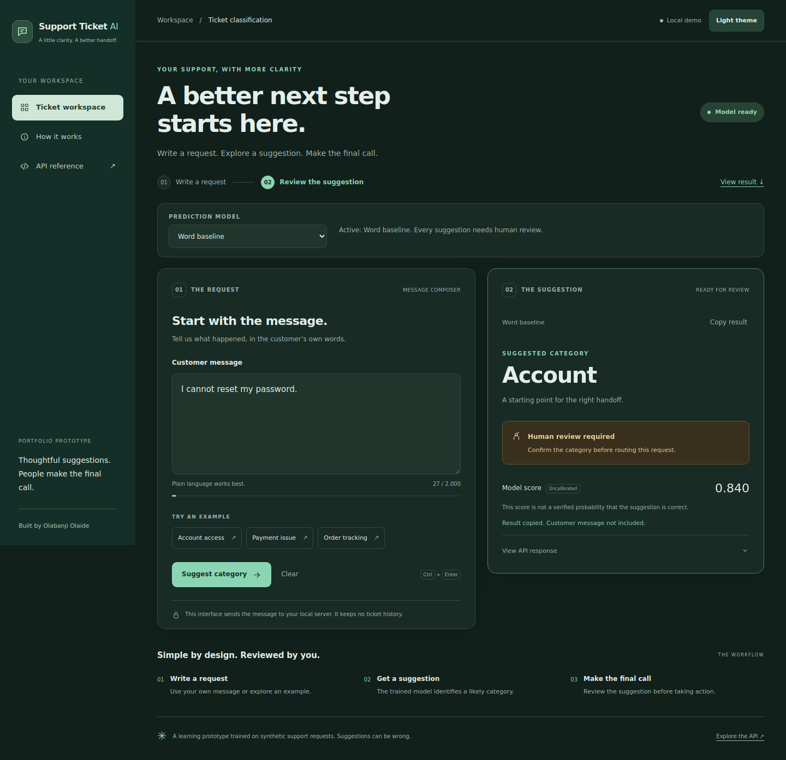
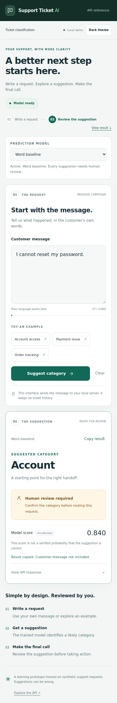

# A more responsive ticket workspace

Package **0.13.0** refreshes the browser workspace with larger type, a calmer green palette, clearer input/result cards, light and dark themes, and layouts for phones through wide desktop screens. The interaction changes give immediate feedback while the existing prediction request runs; they do not claim faster inference or better model accuracy.



## What changed

- The desktop sidebar and two-column workspace become a compact header and stacked cards on smaller screens. Desktop results stay visible while scrolling the composer. Mobile form actions stay within reach while scrolling through the composer.
- An expanding message field, character-limit indicator, example buttons and a two-step progress indicator make the current task visible. Editing a message or changing model options clears the old result.
- **Ctrl+Enter** or **Cmd+Enter** submits a valid ready request. Empty, oversized and unavailable-model requests remain disabled.
- Loading shows elapsed time rather than an invented completion percentage. **Cancel request** or **Escape** stops waiting in this tab and re-enables editing. The local server may continue processing a cancelled request; this does not stop model execution.
- **Copy result** copies the category/review summary and uncalibrated score without the customer message. Clipboard permission failures produce a manual-copy explanation.
- A light/dark theme toggle follows the system preference initially and remembers an explicit choice. Only the theme preference is persisted; ticket text and prediction history are not saved by the interface.
- Focus moves to the result after success, or to an error after failure. Keyboard focus indicators, live announcements, minimum mobile message-font size and reduced-motion styling support accessible use. This is not a claim of comprehensive accessibility certification.

Human review remains required. Scores stay explicitly uncalibrated. Word and semantic model selection, unavailable-model behavior, response checks and the optional existing separate-request setting retain their API contract. The recent offline clarification/problem-statement prototypes are not activated by this visual update.

## Try it on Windows

Stop the running server with **Ctrl+C**, then run these commands in the repository directory:

```bat
conda activate base
git pull --ff-only
conda activate support-ticket-ai
python -m support_ticket_ai.serve --model-dir artifacts/demo-v1/model --semantic-model-dir artifacts/semantic-v1
```

Use the existing environment and bundle paths that already work on your computer. Semantic mode is optional; omit its flag if you only have the word bundle. No model rebuild, new labeling or frontend dependency installation is required. Installed-package users should rebuild/reinstall the updated wheel.

Open **http://127.0.0.1:8000/** and refresh with **Ctrl+F5** if the browser still shows the old styles. Try an example, submit with the keyboard, change themes, copy a result, and resize the window. A fast model may finish before you can cancel; cancellation is most visible on slower requests.

## Phone and dark views





## Verification

The browser checker exercises widths **320, 390, 768, 1024 and 1440 pixels** in both themes, including no horizontal overflow, real word-model predictions, keyboard submission, clipboard success/failure, Unicode-aware input limits, loading, cancellation, connection failure/retry, readiness recovery and reduced motion. It checks semantic selection and multi-request abstention using explicit UI response stubs; those checks do not run or measure semantic inference.

```bash
python -m pip install -r requirements-checks.txt
python -m playwright install chromium
python scripts/check_workspace_ui.py artifacts/demo-v1/model
```

Omit the model path to use a generated synthetic fixture. The same interactions are checked against an installed wheel outside the source checkout. The package workflow now includes this browser checker and uploads its screenshots as CI artifacts. Local checks do not imply that a remote workflow has completed.

Local results: **185 tests passed; one optional Torch test skipped** because Torch was unavailable. JavaScript syntax checking, wheel/source builds and packaged-asset byte checks passed. The source-browser run uses the existing real word bundle; the installed-wheel run uses the generated synthetic fixture. No private review data or reserved evaluation collections are needed.
