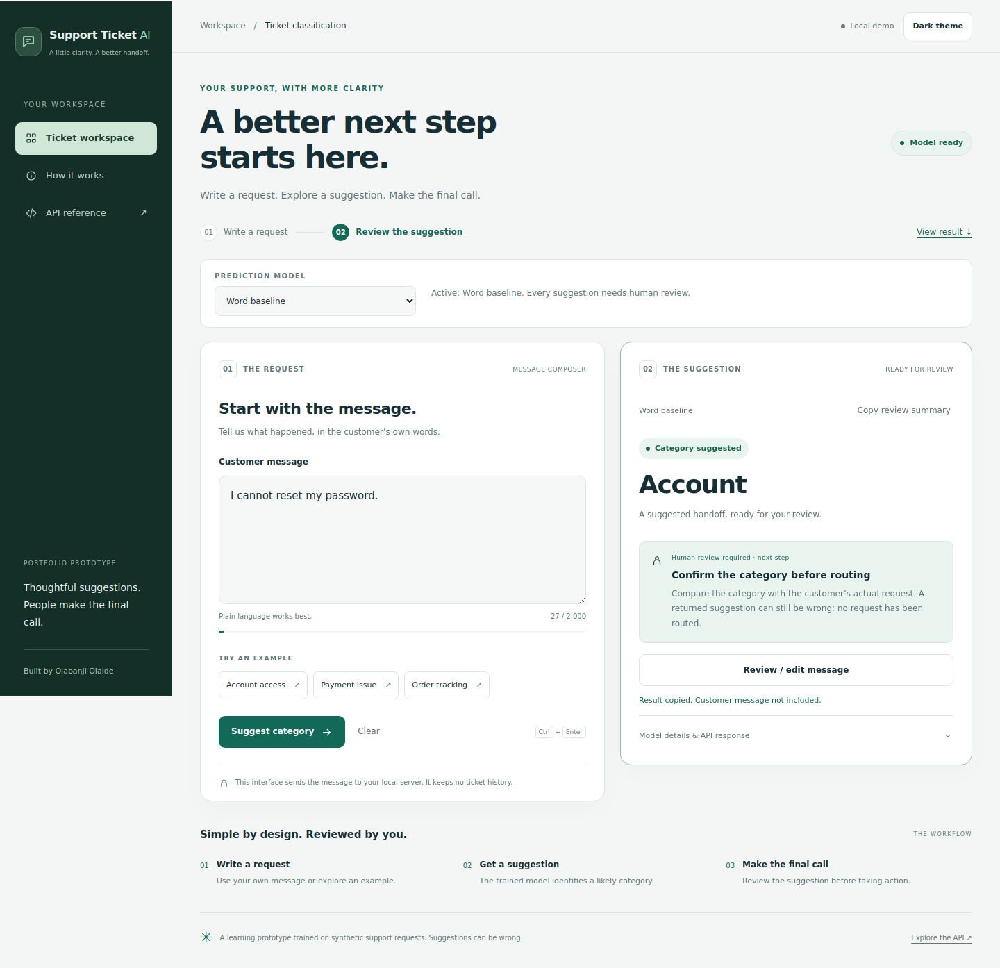
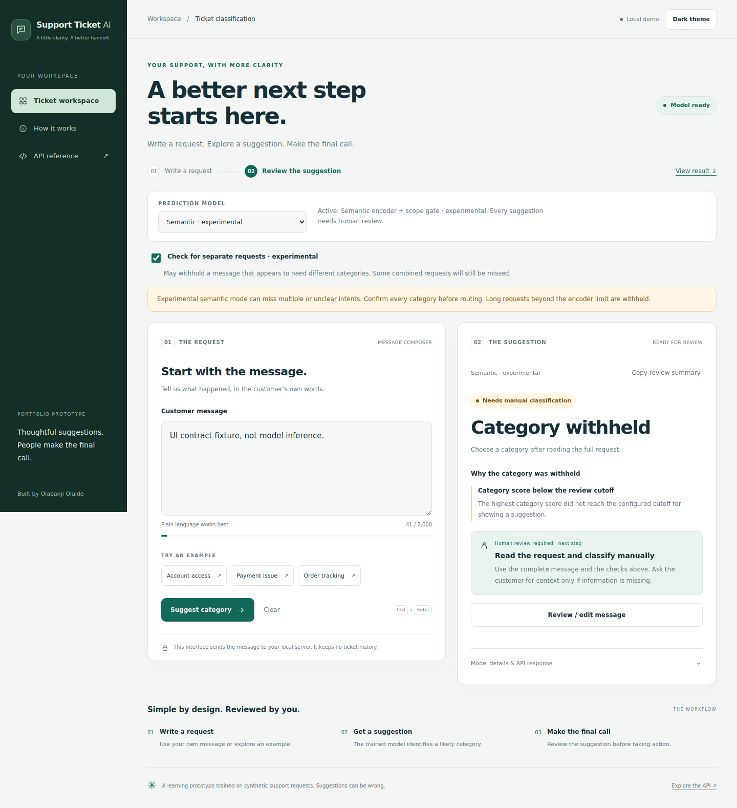
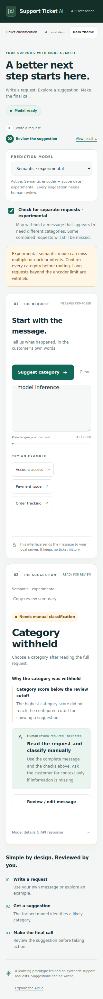

> The [saved-request workspace](38-request-management.md) now adds explicit persistence and human review/handling. The classification card described here remains available for unsaved predictions.

# A result card built around the review decision

Package **0.14.0** organizes every completed result around three questions: **What was returned? Why was a category withheld, if applicable? What should I do next?** This improves the presentation of existing predictions; the API contract, model weights and cutoffs stay the same.

## Suggested and withheld results

A returned category gets a **Category suggested** status, its category name and an explicit task: **Confirm the category before routing**. The card reminds the reviewer to compare it with the full request. It does not pretend to explain which words or learned features caused the classifier to choose that category.

An abstention gets **Needs manual classification** and **Category withheld**. Its explanation uses the response's structured fields:

| Returned evidence | Explanation shown |
|---|---|
| Category score below its returned category cutoff | Category score below the review cutoff |
| Scope score below its returned scope cutoff | Supported-request check withheld this message |
| `input_truncated: true` | Full message not considered |
| `multiple_requests_detected: true` | Separate-request check flagged the message |
| Abstention without a recognized structured condition | The service withheld a category; consult its recorded note |

Every applicable reported condition is shown, rather than hiding additional checks behind the first reason. Score comparisons use the original numbers; rounding for display does not change the cutoff decision. Equality is not described as falling below a cutoff. Missing, nonfinite, string or out-of-range values cannot manufacture a numeric reason.

The scope wording does not declare a request definitely unsupported. A separate-request flag is evidence from the experimental check, not verified customer intent. A missing flag does not establish a single request. The original service `review_reason` remains available verbatim, rendered as text in the details section. Free-text notes are not parsed to invent structured reasons.

## Next action and details

The main card gives the reviewer a next step, with specific guidance for separate-request flags. **Review / edit message** returns keyboard focus to the original message without deleting it, changing the model, or submitting another request. Typing clears the old result.

**Copy review summary** copies the displayed status, category/withholding explanation and next step. It excludes the customer message and raw model scores. Clipboard failure explains how to copy text manually. No result is approved, saved or routed by these controls.

The initially collapsed **Model details & API response** section contains uncalibrated category/scope scores, returned cutoffs, encoder-truncation status, the separate-request-check status, the recorded review note and JSON. Missing values are labelled as absent, not zero. The technical disclaimer separates review-policy explanations from explanations of learned category choice. Opening details releases the desktop card's sticky positioning so a long result remains readable.

## Errors and cancellation

Connection and prediction failures show a dedicated **Request not completed** result, with the error and a **Retry suggestion** action. Retry preserves the message and selected options and stays disabled while the model is unavailable or the input is invalid. The existing connection-status check remains available for recovery.

Cancellation shows **Request cancelled**, preserves the message and returns focus to it. Cancellation stops waiting in this tab; the server may continue processing. Empty, loading, suggested, withheld, error and cancelled states remain distinct, so an old result is not presented as the outcome of a failed request.

Light/dark styling, mobile layout, keyboard shortcuts, human-review requirements and reduced-motion support from the [responsive workspace](36-responsive-workspace.md) remain available. The offline clarification and problem-statement prototypes remain offline.

## Screenshots

The suggestion screenshot uses a real existing word bundle. Withholding screenshots use explicit UI-only response fixtures, not measured semantic inference.







## Update on Windows

Stop the running server with **Ctrl+C**, then use the repository directory:

```bat
conda activate base
git pull --ff-only
conda activate support-ticket-ai
python -m support_ticket_ai.serve --model-dir artifacts/demo-v1/model --semantic-model-dir artifacts/semantic-v1
```

Use the environment and bundle paths that already work on your computer. Semantic mode is optional; omit its flag if you only have the word model. No retraining, model rebuild, new labeling or frontend dependency installation is needed. Installed-package users should rebuild/reinstall the wheel.

Open **http://127.0.0.1:8000/** and refresh with **Ctrl+F5**. Try both a suggestion and a withheld result, inspect the details, copy a summary and return to the message.

## Verification

The pure JavaScript presentation module has ten Node tests for review semantics, multiple simultaneous conditions, missing/invalid fields, cutoff boundaries, generic withholding, preserved raw responses and truthful technical labels. The Python suite checks that the additional module is served as JavaScript. Both are included in CI.

```bash
node --test tests/test_result_view.mjs
python -m unittest discover -s tests -q
python scripts/check_workspace_ui.py artifacts/demo-v1/model
```

The browser checker covers five viewport widths and both themes with real word predictions, then explicitly stubbed score/scope/truncation/multiple-request/generic/combined outcomes at narrow and desktop sizes. It exercises collapsed and expanded details, all recorded reasons, unchanged review requirements, message focus, copy success/failure, safe note rendering, cancellation, error recovery, readiness, Unicode limits and reduced motion. The fixture data is for interface verification, not NLP performance evaluation. CI results should be checked separately after publishing.

Local verification: **185 Python tests passed**, with one optional Torch training test skipped because Torch was unavailable; **10 JavaScript tests passed**. Both source and installed-wheel browser checks passed. Wheel/source builds, JavaScript syntax checks and byte-for-byte packaged-asset checks passed. The semantic outcome profiles are explicit interface stubs; no new semantic-model performance claim is made.
