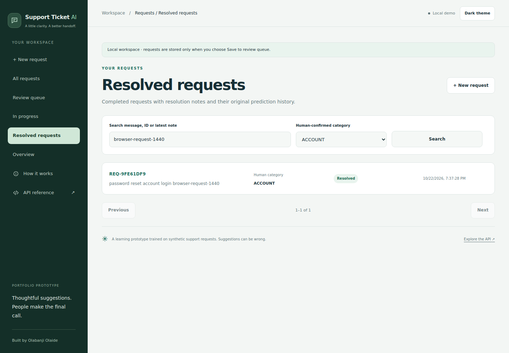
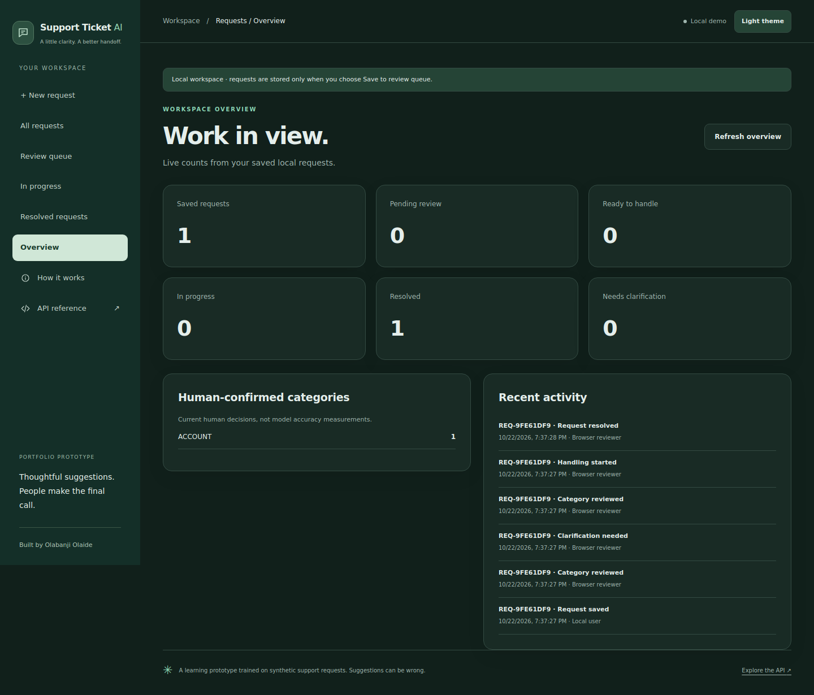
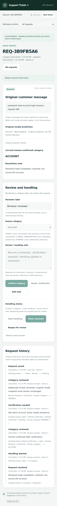

# A workspace for saved requests

Package **0.15.0**, API **0.5.0**, expands the classifier into a local request-management application. All six sections work with the same SQLite database. Counts come from saved records, not demo counters or model accuracy estimates.

| Section | What it does |
|---|---|
| New request | Obtain an unsaved suggestion or explicitly save a message for review. |
| All requests | Browse, search and filter saved messages, notes, status and human-confirmed category. |
| Review queue | Find pending reviews and requests needing clarification. |
| In progress | Track reviewed requests whose handling has started. |
| Resolved requests | Read completed requests, resolution notes, predictions and history. |
| Overview | See saved/pending/ready/in-progress/resolved/clarification counts, current confirmed categories and recent activity. |

The sidebar, mobile section selector, page titles and breadcrumbs follow the selected view. Saved-record links and browser back/forward navigation work through URL fragments; reloading a detail link reopens that record.

## Save deliberately

**Suggest category** still makes a stateless prediction. It does not save a ticket or send it to a team.

**Save to review queue** stores the message locally. Its checked prediction option requests a fresh server-side prediction at save time, preserving model identity, scores, review flags and cutoffs in an immutable snapshot. The browser cannot substitute an invented prediction. The saved snapshot can differ from an earlier unsaved result if the server's model changed in between.

Uncheck the prediction option to save for manual review without a model. This also works when model readiness is unavailable but request storage is working. No prediction is fabricated for a manually saved request. As with the prediction API, surrounding whitespace is trimmed; the stored original message is then immutable.

A saved record has a full UUID, a displayed `REQ-` prefix, created/updated timestamps, a version, message, optional original prediction, current human category, review state, handling state, latest note and optional resolution. Search accepts the displayed short ID or full UUID, message text and the latest note. `%` and `_` are literal search characters. Search is SQLite substring search; ASCII case-insensitivity does not establish full Unicode linguistic matching. Filters for category refer to **human-confirmed** categories, not model guesses. Lists are paginated 20 at a time.

## Classification is separate from resolution

A new request is **Open** with human review **Pending**, displayed as **Awaiting review**. Model suggestions never confirm a category or resolve the request.

| Human action | Preconditions and result |
|---|---|
| Confirm category | Choose a category and reviewer label. Records a human decision; the request stays open/ready to handle, or stays in progress if work already started. |
| Needs clarification | Add an explanatory note. Returns the request to pending review, clears the current confirmed category and preserves the prior decision in history. |
| Start handling | Requires an open request with a reviewed category. Moves it to In progress. |
| Mark resolved | Requires In progress and a reviewed category, plus a resolution note. Records the resolution timestamp. |
| Reopen for review | Requires a resolved request and a note. Returns it to open/pending review, clears its current category/resolution and keeps the previous resolution in history. |
| Add note | Appends a note without silently changing classification or handling status. |

Resolved category/handling decisions cannot be edited until reopening. Notes can still be added to a resolved request. Human category choices use the project's 11-category support taxonomy; the form explains cancellation-fee versus order-cancellation and other label conventions.

For a message combining a delivery inquiry, refund alternative and contact request, a reviewer can choose **Needs clarification** and record what needs deciding instead of accepting the model's single category.

## Inspectable history and conflicting tabs

The saved original message and prediction are not overwritten when a reviewer changes the category. A database trigger rejects source-field updates. Each supported action appends an event with a timestamp, reviewer label, note, version, and before/after lifecycle state in the same database transaction as the record update.

Reviewer labels are self-reported; this local single-user prototype does not authenticate identities. History is append-only through the API, not tamper-proof against someone editing the database file directly.

Each update supplies the version the reviewer saw. If another tab changed that request, the API rejects the stale update with **409**. The interface retains the draft note; reload the saved request, inspect the changes and submit again deliberately. Save requests carry an idempotency key: retrying an identical save after a lost response creates no duplicate record or repeated creation event. A different payload cannot reuse that save key.

Overview values reflect current saved state. Pending-review counts include clarification cases, so those cards overlap; they should not be summed as separate populations. Human-confirmed category totals describe current decisions and are not independently adjudicated ground truth or classifier accuracy. Reviews do not automatically retrain a model.

## Run on Windows

Stop the current server with **Ctrl+C**, then run from `C:\Users\User\support-ticket-ai`:

```bat
conda activate base
git pull --ff-only
conda activate support-ticket-ai
python -m support_ticket_ai.serve --model-dir artifacts/demo-v1/model --semantic-model-dir artifacts/semantic-v1
```

Open **http://127.0.0.1:8000/** and refresh with **Ctrl+F5**. The server creates **`artifacts/requests.sqlite3`** on first launch. Existing messages from before this feature are not retroactively saved. New accounts or a separate database installation are unnecessary. Semantic mode is optional; omit its flag if you only use the word bundle. Use the environment and model paths that already work on your computer.

To choose another database:

```bat
python -m support_ticket_ai.serve --model-dir artifacts/demo-v1/model --requests-db artifacts/my-requests.sqlite3
```

Keep the same path across restarts to retain records. To back up the database, stop the server and copy that file. SQLite is included in Python; this adds no application dependency. Direct `create_app`/Uvicorn users must supply `requests_db` or the `SUPPORT_TICKET_REQUESTS_DB` environment variable to enable persistence. If storage fails, stateless predictions remain available and the workspace reports the storage issue.

The database contains saved message text and notes in a local file. It is not encrypted or an authenticated multi-user service. The CLI binds to loopback; use synthetic examples for this portfolio prototype. Database files and the default artifact directory are excluded from git, and no local database is published with the code.

## API and implementation

| Endpoint | Operation |
|---|---|
| `GET /workspace/config` | Storage availability, review categories and annotation notes. |
| `POST /requests` | Explicit save, optional fresh server prediction and idempotent retries. |
| `GET /requests` | Search/filter/page saved records. |
| `GET /requests/{id}` | Record, immutable prediction and ordered history. |
| `POST /requests/{id}/actions` | Version-checked human review and lifecycle actions. |
| `GET /requests/overview` | Counts, current confirmed categories and recent activity. |

Explore request schemas at **/docs**. Existing **/predict**, readiness and model-selection contracts remain compatible. New persistence endpoints are additive.

The storage module uses short-lived SQLite connections, parameterized SQL, foreign keys, schema-version checks and transactional writes. A read transaction keeps page counts and rows, or overview aggregates, consistent within each response. This is a local workflow implementation, not a throughput benchmark. The recent offline clarification and problem-statement experiments remain offline.

## Learn and verify

This milestone demonstrates relational persistence, API validation, idempotent creation, optimistic concurrency, transactional event history, explicit lifecycle rules, real-state aggregates and accessible navigation across multiple views.

```bash
python -m unittest discover -s tests -q
node --test tests/test_result_view.mjs
python scripts/check_request_workflow.py
```

The workflow browser checker generates synthetic requests and a small word-model fixture in a temporary directory. It exercises all six views, corrections without prediction replacement, clarification, handling, required resolution notes, reopening, search/category filters, stored-text rendering, conflicting tabs and preserved draft notes. It runs at 1440px, 390px and 320px in light/dark views and checks persistence after restarting the server. Existing five-width prediction-interface checks remain available through `scripts/check_workspace_ui.py`.

The installed-package CI workflow runs both browser checkers against the installed wheel outside the source checkout and uploads screenshots. Local results do not imply that the newly triggered remote CI run has finished.

## Screenshots

Screenshots use the browser checker's generated requests and real fixture-model predictions, not real customer data.







Local verification: **201 Python tests passed**, with one optional Torch training test skipped; **10 JavaScript tests passed**. The 16 new workflow API/storage tests cover source immutability, explicit saving, manual review without models, lifecycle rules, required notes, idempotency, stale/concurrent updates, literal search, ID search, filtering/pagination, persistence, generic failures and schema versions. Source and installed-wheel workflow browser runs passed; installed prediction-interface regression checks passed at five widths. Wheel/source builds and packaged-module/asset checks passed, with no database bundled.
